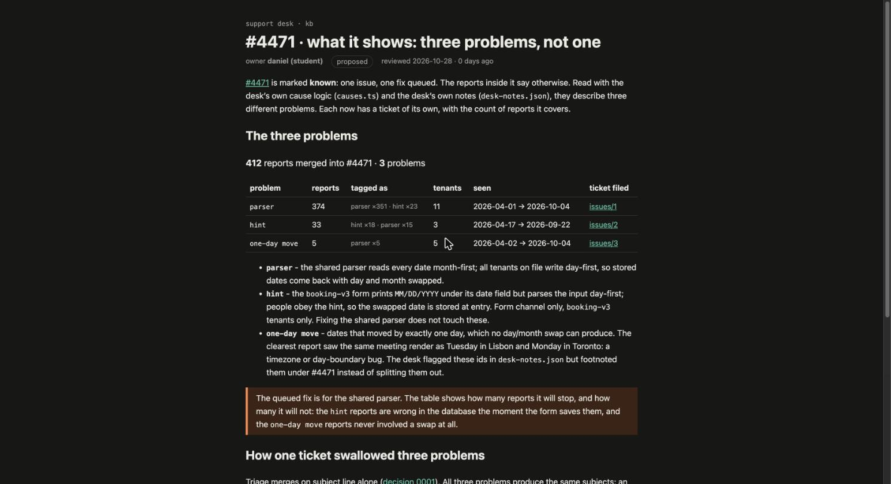

# What #4471 shows: three problems, not one

MEGA.dev challenge S01E03.
The support desk merged 412 reports about wrong booking dates into one ticket, #4471, and marked it known with one fix queued.
Read with the desk's own cause logic and notes, those reports describe three different problems.

## The tickets, one per problem

| issue | problem | reports covered |
|---|---|---|
| [#1](https://github.com/Dan86de/mega-challenge-repo/issues/1) | Shared parser reads dates month-first; day-first tenants get day and month swapped | 374 |
| [#2](https://github.com/Dan86de/mega-challenge-repo/issues/2) | `booking-v3` form hints `MM/DD/YYYY` but parses the input day-first | 33 |
| [#3](https://github.com/Dan86de/mega-challenge-repo/issues/3) | Dates shift by one day across timezones, not a month swap | 5 |

374 + 33 + 5 = 412: each report counts once, under the problem it actually describes.

## The kb page

- Source: [`support-kb/src/routes/kb/incidents/4471-what-it-shows/+page.svx`](support-kb/src/routes/kb/incidents/4471-what-it-shows/+page.svx), signed (desk ref `DR-HWF8-APMY`).
- Counts are computed at render time by [`ProblemTable.svelte`](support-kb/src/lib/kb/ProblemTable.svelte) and [`problems.ts`](support-kb/src/lib/kb/problems.ts), per the kb rule that a number that can be computed belongs in a component.
- As the desk will see it: the prerendered site is in [`rendered/site/`](rendered/site) (the page at `rendered/site/kb/incidents/4471-what-it-shows.html`); screenshots in [`rendered/screenshots/`](rendered/screenshots).



## Building the kb

The export came without build scaffolding; this repo adds the minimal SvelteKit + mdsvex setup (`package.json`, `svelte.config.js`, `vite.config.ts`, `src/app.html`, `src/routes/+layout.ts`) and changes none of the desk's pages or logic.

```sh
cd support-kb
npm install
npm run build   # prerenders the site to build/
npm run preview
```
